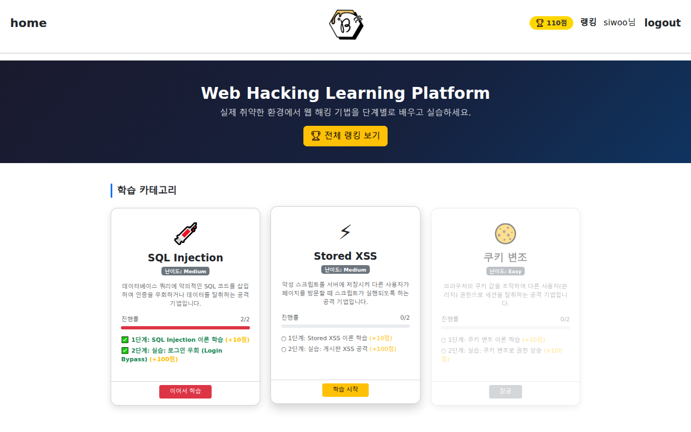
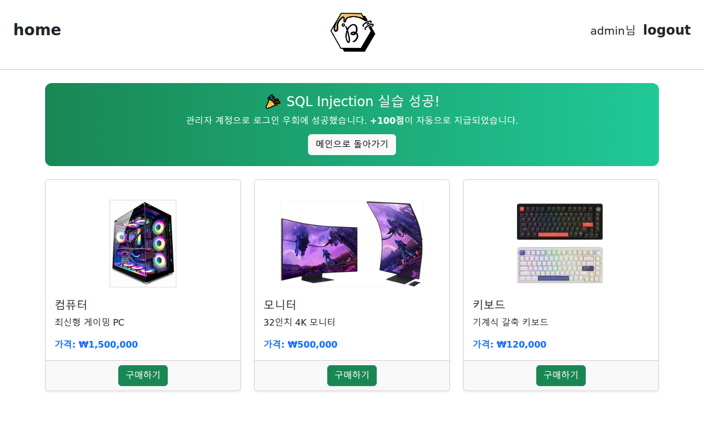
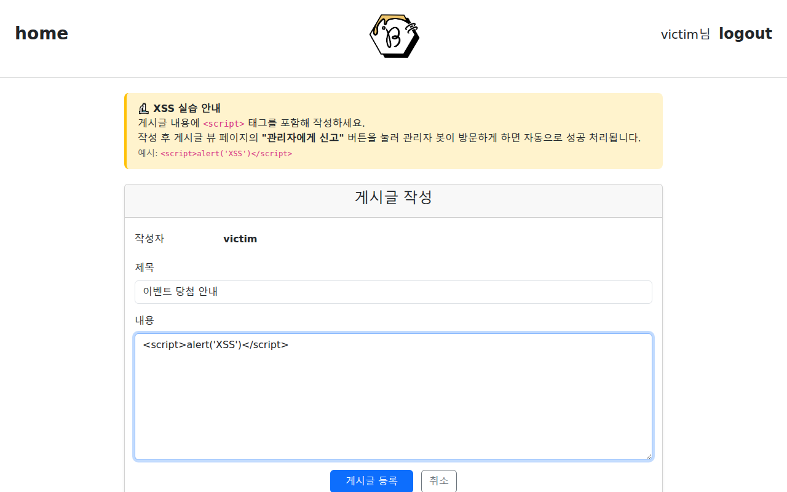
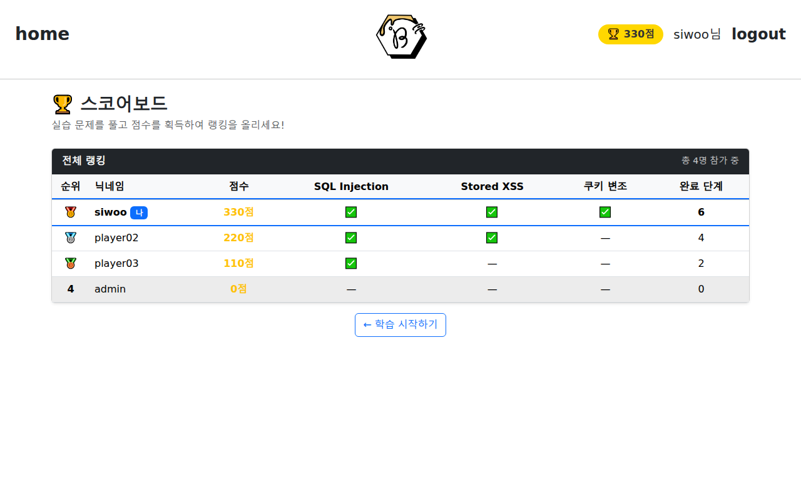

# 🛡️ WHZ — Web Hacking Zone

> 🏆 2026 교내 전공학술회 **대상 (1위)** · 2026.04.24
> SQL Injection · Stored XSS · 쿠키 변조를 "이론 → 실습 → 자동 채점 → 랭킹" 순서로 묶은 웹 해킹 입문 교육 플랫폼입니다.

> [!WARNING]
> 이 저장소의 `shop`, `board` 서비스는 **일부러 취약하게 만든 교육용 코드**입니다.
> SQL Injection, Stored XSS, 쿠키 기반 인증 우회가 의도적으로 남아 있습니다.
> 반드시 로컬(localhost)에서만 실행하고, **공인 IP나 외부망에 절대 노출하지 마세요.**
> DB에 들어 있는 계정은 전부 실습용 더미 계정입니다.

---

## 1. 한 줄 소개

취약한 쇼핑몰과 게시판을 실습장으로 띄워 두고, 공격이 성공하면 **그 서비스가 스스로 감지해서 메인 서버에 점수를 보고**하는 웹 해킹 학습 플랫폼입니다.

| | |
|---|---|
| 📅 기간 | 2026.04 (교내 전공학술회 출품작) |
| 👥 인원 | 3명 (팀명: 춘식이) |
| 🧑‍💻 내 역할 | **팀장** — 전체 구조 설계 / 서비스 간 채점 연동 / Docker 배포 |

**내가 맡은 일**

- 메인 서버 · 쇼핑몰 · 게시판 **3개 서비스를 어떻게 하나의 학습 흐름으로 묶을지** 구조를 짰습니다.
- "플래그를 손으로 입력하는 방식"을 버리고 **HMAC 토큰 기반 자동 채점**으로 설계를 바꿨습니다.
- Docker Compose로 컨테이너 6개(웹 3 + DB 3)를 올리고, 컨테이너끼리 통신하도록 네트워크를 구성했습니다.
- 팀원 2명에게 작업을 나눠 주고, 각자 만든 결과물을 합치는 통합 작업을 했습니다.

---

## 2. 사용 기술


프레임워크 없이 순수 PHP로 만들었습니다. 인증·무결성 검증에는 PHP 내장 `hash_hmac` / `hash_equals`(HMAC-SHA256)를, 서비스 간 호출에는 cURL을 썼습니다.

---

## 3. 왜 만들었나

- **보안 공부를 시작할 데가 마땅치 않습니다.** Dreamhack은 유료 비중이 커지고 난이도가 올라갔고, PortSwigger Web Security Academy는 전문가용이라 비전공 입문자가 첫 문제부터 막힙니다. BoB나 화이트햇 스쿨은 선발 인원이 너무 적습니다.
- **이론만 읽으면 지루해서 금방 그만둡니다.** "SQL Injection은 입력값을 쿼리에 그대로 붙여서 생긴다"는 설명을 읽는 것과, 실제로 `admin' -- ` 를 넣어서 남의 계정으로 로그인되는 걸 보는 것은 체감이 완전히 다릅니다.
- **기존 CTF 방식은 흐름이 끊깁니다.** 문제를 풀고 → 플래그 문자열을 복사해서 → 다른 페이지에 붙여넣어야 점수가 오릅니다. 입문자에게는 이 과정 자체가 하나의 장벽이라고 생각했습니다.

→ **무료 + 낮은 난이도 + 즉시 피드백**으로 입문자를 붙잡아 두는 것을 목표로 잡았습니다.

---

## 4. 어떻게 해결했나

### ① HMAC-SHA256 토큰 기반 자동 채점 (이 프로젝트의 핵심)

**플래그를 손으로 입력하는 과정을 아예 없앴습니다.** 취약 서비스가 공격 성공을 스스로 감지해서, 컨테이너 내부 네트워크로 메인 서버에 점수를 보고합니다.

```
[메인 서버]  실습 시작 버튼
     │  ① HMAC-SHA256 토큰 발급
     │     hash_hmac('sha256', "{유저ID}:{챌린지명}", CHALLENGE_SECRET)
     ▼
[취약 서비스]  /index.php?main_uid=2&token=c86fda...
     │  ② 토큰을 세션(게시판은 게시글 레코드에도)에 저장
     │  ③ 공격 성공을 서비스가 스스로 감지
     ▼
[메인 서버]  POST http://main_web/api/solve.php   ← 도커 내부 네트워크
     │  ④ hash_equals() 로 토큰 재검증
     │  ⑤ user_progress INSERT + score +100 + 다음 단계 해제
     ▼
     이미 푼 문제면 {"already": true} → 중복 지급 차단
```

취약점마다 "성공"을 판정하는 방법이 다릅니다.

| 실습 | 성공 판정 방법 |
|---|---|
| SQL Injection | 쇼핑몰 로그인 결과의 username이 `admin` 이면 인증 우회 성공으로 판정 |
| Stored XSS | 게시글 본문에 `<script` 가 있는 상태에서 "관리자에게 신고"를 누르면 관리자 봇이 열어본 것으로 처리 |
| 쿠키 변조 | 게시판의 `LoginUser` 쿠키 값이 실제 존재하는 계정 범위를 벗어나면 변조로 판정 |

토큰은 **메인 서버와 취약 서비스가 공유한 비밀키로만 만들 수 있기 때문에**, 사용자가 `api/solve.php`를 직접 호출해서 점수를 자가 지급할 수 없습니다. 비밀키는 환경변수(`CHALLENGE_SECRET`)로 분리해 두었습니다.

### ② 이론 → 실습 순서 잠금형 로드맵

카테고리 3개가 각각 `이론(10점)` + `실습(100점)` 2단계로 되어 있고, **앞 단계를 끝내야 다음이 열립니다.** 이전 카테고리의 실습을 통과하지 못하면 다음 카테고리는 🔒 상태로 잠겨 있습니다. 이론 페이지에는 취약한 코드 예시, 공격 페이로드 표, 방어 방법(Prepared Statement, `htmlspecialchars`, 서명된 세션)까지 같이 넣었습니다.

### ③ 점수 · 스코어보드

만점 330점(= (10+100) × 3). 스코어보드에서 전체 랭킹과 취약점별 해결 여부(✅ / —)를 한눈에 볼 수 있고, 상위 3명은 🥇🥈🥉으로 표시됩니다. 상단 네비게이션에는 항상 현재 점수가 떠 있습니다.

---

## 5. 실행 화면

| | |
|---|---|
|  |  |
| **학습 홈** — 카테고리 3개와 진행률. SQL Injection은 2/2 완료, Stored XSS는 진행 중, 쿠키 변조는 앞 단계를 끝내야 열리므로 🔒 잠김 상태입니다. | **SQL Injection 실습 성공** — 쇼핑몰 로그인에 `admin' -- ` 를 넣어 인증을 우회하면, 쇼핑몰이 스스로 성공을 감지해 메인 서버에 보고하고 **+100점이 자동 지급**됩니다. |
|  |  |
| **Stored XSS 실습** — 게시판 글쓰기 화면. 내용에 `<script>alert('XSS')</script>` 를 저장한 뒤 "관리자에게 신고"를 누르면 관리자 봇이 글을 열어본 것으로 처리되어 채점됩니다. | **스코어보드** — 점수 순 전체 랭킹. 취약점별 해결 여부와 완료 단계 수가 같이 표시되고, 본인 행은 파란 테두리로 강조됩니다. |

---

## 6. 어려웠던 점과 해결 과정

**1) 팀장으로서 팀원을 이끄는 것**

기술보다 이게 제일 어려웠습니다. 서비스가 메인·쇼핑몰·게시판 3개로 나뉘어 있다 보니 각자 맡은 부분만 만들면 합칠 때 안 맞았습니다. 그래서 **"서비스끼리 주고받는 규격"(토큰 형식, API 파라미터 이름, 쿠키 이름)을 제가 먼저 정해서 공유하고**, 각자 그 규격에 맞춰 만들게 했습니다. 혼자 다 하는 게 빠를 것 같은 순간이 몇 번 있었는데, 그렇게 하면 팀이 아니라서 참고 역할을 나눴습니다.

**2) 설계를 중간에 갈아엎은 것**

처음에는 흔한 CTF처럼 `FLAG(sql_injection_success)` 같은 문자열을 찾아서 입력창에 붙여넣는 방식으로 만들었습니다. 그런데 직접 써 보니 "문제를 푼 것"과 "점수를 받는 것"이 따로 놀아서 흐름이 끊겼습니다. 결국 **자동 채점 방식으로 전면 재설계**했는데, 이때 "그럼 취약 서비스가 메인 서버한테 점수를 달라고 하면, 사용자가 그 요청을 흉내 내면 어떡하지?"라는 문제가 생겼습니다. 이걸 **공유 비밀키로 만든 HMAC 토큰을 검증하는 방식**으로 풀었습니다.

**3) Docker 환경에서 서비스끼리 통신시키기**

WSL + Docker 환경에 올리는 과정이 생각보다 오래 걸렸습니다. 특히 취약 서비스가 메인 서버를 어떤 주소로 불러야 하는지가 헷갈렸는데, 브라우저가 보는 주소(`localhost:8001`)와 **컨테이너끼리 보는 주소(`http://main_web`)가 다르다**는 걸 이해하고 나서 해결했습니다. 같은 Docker 네트워크에 묶으면 컨테이너 이름이 그대로 호스트명이 됩니다.

---

## 7. 배운 점 / 다음에 개선할 점

**배운 점**

- 계속 팀장과 회장을 맡다 보니 **리더가 할 일은 "제일 많이 하는 것"이 아니라 "일이 합쳐지게 만드는 것"** 이라는 걸 배웠습니다. 이번에는 인터페이스를 먼저 정하는 게 그 역할이었습니다.
- 취약점을 **공격하는 쪽과 막는 쪽을 둘 다 코드로 써 봤습니다.** 메인 서버는 Prepared Statement를 쓰고, 실습용 쇼핑몰은 일부러 문자열을 이어 붙여 쿼리를 만듭니다. 같은 로그인 기능을 두 가지로 만들어 보니 차이가 확실히 보였습니다.
- 서명(HMAC)이 왜 필요한지 몸으로 알게 됐습니다. "믿을 수 없는 쪽에서 온 요청"을 어떻게 구분하는가가 결국 핵심이었습니다.

**개선할 점**

- **쿠키가 포트를 구분하지 않는다는 걸 몰랐습니다 (가장 큰 설계 결함).**
  브라우저 쿠키는 도메인만 보고 포트는 구분하지 않습니다. 그래서 `localhost:80`(메인), `:8001`(쇼핑몰), `:8002`(게시판)이 전부 같은 `LoginUser` 쿠키를 덮어씁니다. 그 결과:
  - 쇼핑몰에서 SQL Injection으로 admin이 되면 메인 서버 쪽 로그인 상태까지 같이 바뀝니다.
  - 더 심각한 건, **메인에 3번째 이후로 가입한 사용자는 게시판에 접속만 해도 쿠키 변조 실습이 그냥 통과됩니다.** 게시판은 "`LoginUser` 값이 게시판 계정 범위(1~2)를 벗어나면 변조"로 판정하는데, 메인에서 받은 ID가 이미 그 범위 밖이기 때문입니다.
  - 지금이라면 실습장마다 쿠키 이름을 다르게 하거나(`shop_user`, `board_user`), 서브도메인/경로를 분리하고, 메인 서버는 쿠키 대신 서명된 세션을 쓰도록 고치겠습니다.
- **메인 서버가 비밀번호를 평문으로 저장합니다.** 실습용 쇼핑몰·게시판은 의도한 거라 쳐도, 일반 회원가입이 있는 메인 서버는 변명의 여지가 없습니다. `password_hash()` / `password_verify()`로 바꿔야 합니다.
- **메인 서버의 인증이 쿠키 값 하나에 의존합니다.** 이론 페이지에 제가 직접 "서명 없는 쿠키를 믿으면 안 된다"고 써 놓고, 정작 메인 서버가 `LoginUser` 쿠키의 숫자만 보고 사용자를 판단하고 있습니다. 세션 기반으로 바꿔야 합니다.
- **옛 설계의 잔재가 남아 있습니다.** `*_FLAG.php` 4개는 플래그 입력 방식일 때 쓰던 파일로 지금은 어디서도 링크되지 않고, 그중 2개는 PHP 8에서 실행하면 에러가 납니다. 재설계 과정을 보여주는 기록이라 남겨 두었지만 정리 대상입니다.
- 이론 완료 처리 로직이 `category.php`와 `api/theory_done.php` 두 군데에 중복 구현돼 있습니다.

**앞으로 만들고 싶은 것** (아직 구현하지 않았습니다)

- 정답이 아니라 힌트를 주는 실습 도우미 AI
- 자주 틀리는 취약점 유형을 분석해 복습 퀴즈를 만들어 주는 오답 노트
- 연속 학습 스트릭(🔥) 기능

---

## 실행 방법

```bash
cp .env.example .env     # CHALLENGE_SECRET 값을 직접 채워 주세요
docker compose up -d --build
```

| 서비스 | 주소 | 설명 |
|---|---|---|
| 메인 학습 플랫폼 | http://localhost/ | 이론 · 실습 · 스코어보드 |
| 쇼핑몰 (실습장) | http://localhost:8001/ | SQL Injection |
| 게시판 (실습장) | http://localhost:8002/ | Stored XSS · 쿠키 변조 |

- MySQL 초기화에 **20~40초** 정도 걸립니다. "DB 연결 실패"가 뜨면 잠시 후 새로고침하세요.
- 회원가입으로 계정을 만들거나, 시드 계정 `admin / admin123` 으로 로그인할 수 있습니다.
- 정리: `docker compose down -v`

```
whz-security-playground/
├── docker-compose.yml      # 컨테이너 6개 (web×3 + mysql×3)
├── main/                   # :80   학습 플랫폼 본체
│   ├── db/init_main.sql
│   └── src/
│       ├── index.php       # 카테고리 카드 · 진행률 · 잠금
│       ├── category.php    # 이론 본문 · 실습 안내 · 토큰 발급
│       ├── scoreboard.php  # 랭킹
│       ├── config.php      # 카테고리 정의 · HMAC 함수
│       └── api/solve.php   # 자동 채점 API ★
├── shop/                   # :8001 SQL Injection 실습장
└── board/                  # :8002 Stored XSS · 쿠키 변조 실습장
```
